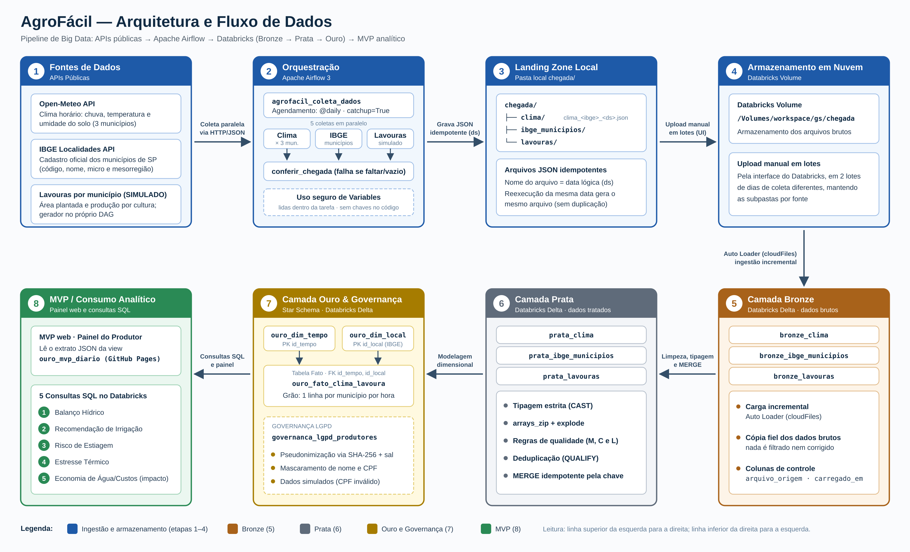
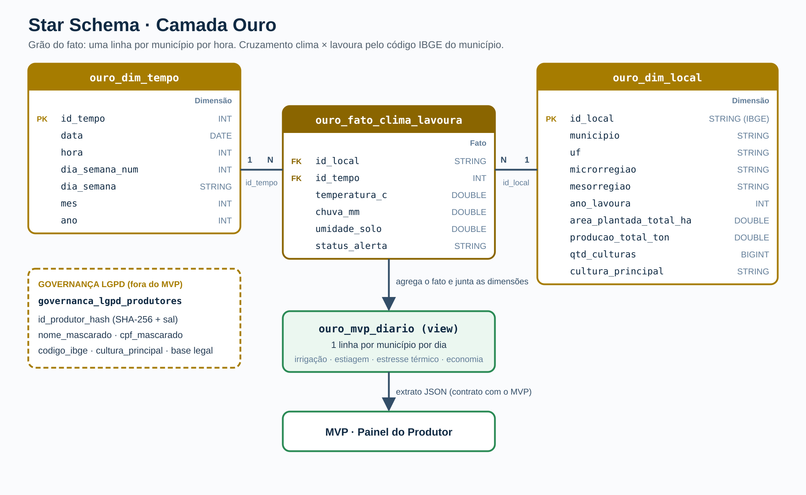

# 🌱 AgroFácil · Global Solution · Big Data Architecture & Data Integration

> **AgroFácil diz ao produtor rural, com dados de clima e da sua lavoura, se ele precisa irrigar hoje e quanta água e dinheiro a chuva já poupou.**

Pipeline de dados ponta a ponta: coleta agendada no **Apache Airflow 3**, lakehouse no **Databricks Free Edition** (Volume → Bronze → Prata → Ouro, Delta), governança **LGPD** e um **MVP** web que lê a camada Ouro.

## 👥 Integrantes

| Nome completo | RM |
| :-- | :-- |
| Julia Ortiz | 550204 |
| Julia Palomari | 551910 |
| Leticia Baptista | 550289 |
| Vinicius Sobreira Borges | 97767 |

**MVP (público):** https://palomari.github.io/agrofacil-bigdata/mvp/

---

## 🎯 Perguntas que o MVP responde

1. **Balanço hídrico:** choveu o suficiente para cobrir a necessidade de água da lavoura?
2. **Irrigação:** preciso irrigar hoje?
3. **Estiagem:** há risco de estiagem? Quantos dias seguidos sem chuva relevante?
4. **Estresse térmico:** quantas horas acima de 32 °C a lavoura enfrentou?
5. **Impacto:** quanta água (m³) e quanto dinheiro (R$) deixei de gastar porque choveu?

## 🏗️ Arquitetura



```text
Open-Meteo + IBGE Localidades + Lavouras (simulado)
        │  Airflow 3 · @daily · catchup=True · 5 coletas em paralelo
        ▼
chegada/{clima,ibge_municipios,lavouras}/   (1 arquivo por coleta, data lógica ds no nome)
        │  upload manual em lotes (interface do Databricks)
        ▼
Volume /Volumes/workspace/gs/chegada
        │  Auto Loader (cloudFiles) · incremental
        ▼
Bronze  bronze_clima · bronze_ibge_municipios · bronze_lavouras      (cópia fiel + arquivo_origem + carregado_em)
        │  CAST · arrays_zip/explode · regras de qualidade · QUALIFY · MERGE
        ▼
Prata   prata_clima · prata_ibge_municipios · prata_lavouras
        │  modelagem dimensional
        ▼
Ouro    ouro_fato_clima_lavoura · ouro_dim_tempo · ouro_dim_local   (+ view ouro_mvp_diario · governanca_lgpd_produtores)
        │  extrato JSON
        ▼
MVP     mvp/index.html (GitHub Pages) · 5 consultas SQL
```

Star schema (grão do fato: uma linha por município por hora):



## 📊 Fontes de dados

| Fonte | Origem (URL) | Formato | Frequência | Exige chave? | Pergunta do MVP que ajuda a responder |
| :-- | :-- | :-- | :-- | :-- | :-- |
| **Open-Meteo** (real) | `https://api.open-meteo.com/v1/forecast` | JSON (listas horárias paralelas) | diária (`@daily`), 1 arquivo por município | Não | 1, 2, 3, 4, 5 |
| **IBGE Localidades** (real) | `https://servicodados.ibge.gov.br/api/v1/localidades/estados/SP/municipios` | JSON (lista de municípios) | diária (cadastro quase estático) | Não | cruza clima × lavoura pelo código IBGE; regra "município fora do cadastro" |
| **Lavouras** (**simulada**) | gerador `gerar_lavouras` em `dags/agrofacil_coleta_dados.py` | JSON | diária | Não | 5 (área × chuva = água poupada) e área exposta |

**Sobre a simulação.** O cadastro de lavouras (área plantada e produção por município e cultura) é **simulado**: o gerador está no repositório, é determinístico (semente fixa por município + cultura + ano) e usa produtividades realistas (cana ≈ 80 t/ha, soja ≈ 3,5 t/ha, milho ≈ 6 a 7 t/ha).
Em alguns dias ele injeta **linhas sujas de propósito** (área zero, produção negativa, município inexistente e duplicata) para exercitar as regras de qualidade da Prata.
Nenhum dado pessoal real é simulado: os produtores do módulo LGPD são fictícios (`gerador/gerar_produtores.py`) e seus CPFs têm dígito verificador inválido de propósito.

## 📂 Estrutura do repositório

```text
├── dags/
│   └── agrofacil_coleta_dados.py              # DAG de coleta + gerador de lavouras simuladas
├── databricks/
│   └── notebooks/pipeline_agrofacil.ipynb     # notebook único, exportado COM as saídas (Bronze → Prata → Ouro → consultas → LGPD → extrato)
├── mvp/                                        # painel do produtor: index.html + dados_ouro.json (extrato da Ouro)
├── amostras/                                   # um arquivo real de cada fonte (clima, IBGE, lavouras)
├── gerador/gerar_produtores.py                 # produtores FICTÍCIOS para a demonstração de LGPD
├── docs/                                       # diagramas (arquitetura e star schema)
└── README.md
```

## ▶️ Como reproduzir o pipeline

### 1. Airflow (coleta)
1. Instale o **Airflow 3** num ambiente virtual e aponte o `dags_folder` para a pasta `dags/` deste repositório. Rode com `airflow standalone`.
2. Por padrão o DAG grava em `chegada/` na raiz do repositório. Para outro local (ex.: container), defina `AGROFACIL_CHEGADA=/caminho/chegada`.
3. *Admin → Variables*:
   * `AGROFACIL_MUNICIPIOS` (opcional): JSON com `codigo_ibge`, `nome`, `lat` e `lon`. Sem ela vale o padrão do DAG (Campinas, Ribeirão Preto e Piracicaba). É lida **dentro** da função da tarefa.
   * `AGROFACIL_SECRET_KEY`: o **sal** do hash de LGPD (o valor aparece oculto). As APIs usadas **não exigem chave**.
4. Ative o DAG `agrofacil_coleta_dados`. Com `catchup=True` e `start_date = 2026-10-25`, o Airflow gera uma execução por dia (25 dias, de 25/10 a 18/11).
   Cada execução grava 5 arquivos (3 de clima, 1 do IBGE e 1 de lavouras), e a tarefa `conferir_chegada` falha se algum faltar, estiver vazio ou tiver JSON inválido.

Resultado esperado: `chegada/clima` com 75 arquivos, `chegada/ibge_municipios` com 25 e `chegada/lavouras` com 25.

### 2. Lotes no Volume
Separe os arquivos por data em dois lotes (lote 1: 25/10 a 06/11; lote 2: 07/11 a 18/11), mantendo a mesma estrutura de subpastas:

```bash
for f in chegada/*/*.json; do
  ds=${f##*_}; ds=${ds%.json}
  if [[ "$ds" < "2026-11-07" ]]; then lote=lote1; else lote=lote2; fi
  pasta=$(basename "$(dirname "$f")")
  mkdir -p "lotes/$lote/$pasta" && cp "$f" "lotes/$lote/$pasta/"
done
```

No Databricks: *Catalog → workspace → gs → chegada*. Envie o **lote 1** nas pastas `clima/`, `ibge_municipios/` e `lavouras/` (Upload to this volume) e, mais tarde, o **lote 2**.

### 3. Databricks
Importe `databricks/notebooks/pipeline_agrofacil.ipynb` (*File → Import*). É um notebook único, em seções numeradas. Rode de cima para baixo, uma célula por vez:

| Seção | O que faz | Parâmetros (barra de widgets) |
| :-- | :-- | :-- |
| 00 · Setup e lotes | cria schema, Volume e pastas; reset opcional; lista o Volume | `resetar`, `apagar_arquivos`, `momento` |
| 01 · Bronze | Auto Loader nas 3 pastas, contagens e `DESCRIBE HISTORY` | `momento` |
| 02 · Prata | 3 tabelas, regras de qualidade e 2 MERGEs de cada | n/a |
| 03 · Ouro | star schema, integridade e view `ouro_mvp_diario` | n/a |
| 04 · Consultas | as 5 consultas SQL, com interpretação | n/a |
| 05 · LGPD | tabela de governança com hash e máscara | `sal` (**não versionar**) |
| 06 · Extrato | gera `dados_ouro.json` | n/a |

**Reset:** a célula de reset só apaga algo se `resetar = sim`. Mantenha `apagar_arquivos = nao` depois de subir os lotes, ou os JSON enviados também serão apagados.

**Demonstração do incremental (requisitos 4 e 5):**
1. Setup (e reset, se for repetir) → envie o **lote 1** → `momento = 1_apos_lote1` → rode a listagem e a Bronze.
2. Envie o **lote 2** → `momento = 2_apos_lote2` → rode a listagem e a Bronze.
3. Sem enviar nada → `momento = 3_reexecucao_sem_arquivo_novo` → rode a Bronze de novo (**acrescenta 0 linhas**).

**Valores esperados** (25 dias, de 25/10 a 18/11):

| Tabela | Esperado |
| :-- | :-- |
| `bronze_clima` | 75 linhas (3 municípios × 25 dias; 1 linha por arquivo) |
| `bronze_ibge_municipios` | 16.125 linhas (645 municípios × 25 arquivos) |
| `bronze_lavouras` | 242 linhas (25 × 9 + 12 sujas + 5 duplicatas) |
| `prata_clima` | 1.800 linhas (75 × 24 horas) |
| `prata_ibge_municipios` | 645 linhas |
| `prata_lavouras` | 9 linhas |
| Regras L1, L2, L3, L4 | 4, 4, 4, 0 |
| Regras M1, M2, C1 a C6 | 0 (dados reais limpos) |
| 2º `MERGE` de cada Prata | 0 inseridas, 0 atualizadas |

### 4. MVP
1. A seção 06 do notebook gera o `dados_ouro.json`. Baixe-o em *Catalog → workspace → gs → chegada → `_export`*.
2. Salve em `mvp/dados_ouro.json` e faça *commit*. Ative o **GitHub Pages** (*Settings → Pages* → branch `main`, pasta `/ (root)`).
3. O painel fica em `https://palomari.github.io/agrofacil-bigdata/mvp/`.
4. Para testar no computador: `cd mvp && python3 -m http.server 8000` e abra `http://localhost:8000`.

## 📐 Premissas e regras de negócio

* Necessidade hídrica de referência: **3,5 mm/dia**. **1 mm sobre 1 ha = 10 m³.** Custo da água: **R$ 1,85/m³** (premissa ajustável).
* Água poupada no dia = área plantada (ha) × 10 × MIN(chuva do dia, 3,5 mm). É uma **estimativa teórica**, pois supõe que toda a área seria irrigada.
* Dia seco: chuva do dia < 1 mm. Estiagem: ≥ 10 dias secos seguidos = ALTO; ≥ 5 = MÉDIO.
* Estresse térmico: temperatura > 32 °C. Irrigação ALTA: chuva < 2 mm e (temperatura média > 28 °C ou solo < 0,20 m³/m³).
* Horários em `America/Sao_Paulo` (parâmetro `timezone` da Open-Meteo), para o "dia" fechar à meia-noite de Brasília.

## ✅ Qualidade de dados (Prata)

| Tabela | Chave |
| :-- | :-- |
| `prata_ibge_municipios` | `codigo_ibge` |
| `prata_clima` | `codigo_ibge` + `data_hora` |
| `prata_lavouras` | `codigo_ibge` + `ano_referencia` + `cultura` |

Regras: **M1 e M2** (código e nome do município), **C1 a C6** (data/hora nula, chuva negativa, temperatura fora de −10 a 50 °C, umidade fora de 0 a 1, leitura nula, município fora do cadastro) e **L1 a L4** (área ≤ 0, produção negativa, município fora do cadastro, produtividade implausível).
A contagem de linhas barradas por regra fica em `prata_qualidade_regras`.

## 🔒 LGPD e contrato com o MVP

* Clima, cadastro de municípios e lavouras **não têm dado pessoal** (nível município).
* Dados pessoais de produtores (**simulados**): CPF → `sha2(cpf + sal, 256)` e máscara `***.456.789-**`; nome → máscara; e-mail, telefone e localização exata **não são coletados**.
* Base legal (simulação): Art. 7º, V da LGPD (execução de contrato). O **sal não está no repositório**: fica na Variable `AGROFACIL_SECRET_KEY` e é informado no widget `sal` do notebook.
* Contrato com o MVP: view `workspace.gs.ouro_mvp_diario` (1 linha por município por dia), atualizada diariamente e lida pelo MVP como extrato JSON (`dados_ouro.json`). Colunas e tipos estão na seção 06 do notebook.

## ⚠️ Limitações conhecidas

* O Databricks Free Edition não se conecta ao Airflow: o envio dos lotes é manual, por desenho do enunciado.
* A Open-Meteo `/v1/forecast` traz previsão para as horas ainda não ocorridas do dia corrente.
* As lavouras são simuladas. O passo seguinte seria usar a Produção Agrícola Municipal real (IBGE/SIDRA).